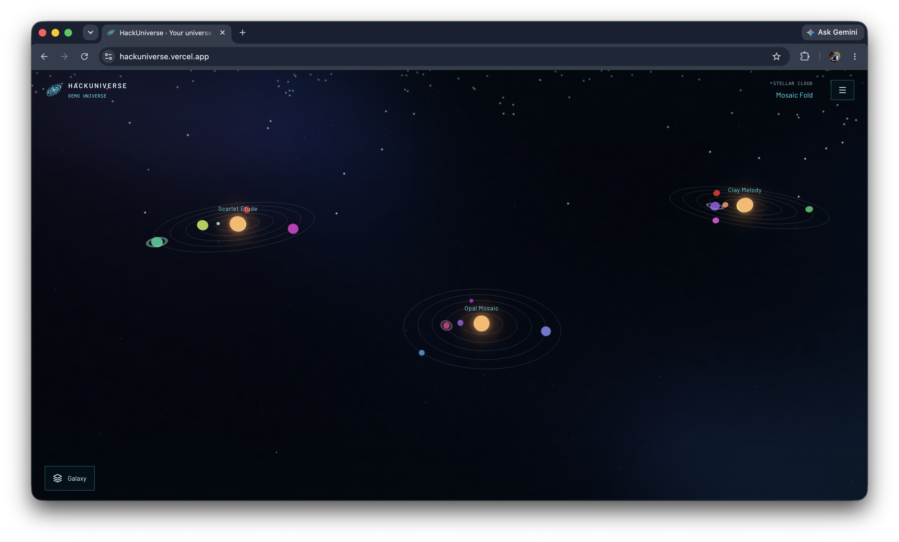
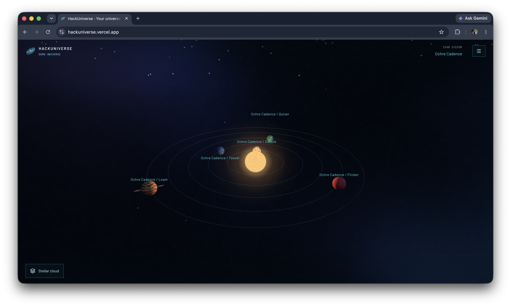

# HackUniverse

https://github.com/user-attachments/assets/71ee72c3-f5f6-4b40-8359-383dcdcb93ad

**TL;DR:** Turn websites into planets and organize them into systems, galaxies and universes. The working 3D demo includes smooth exploration, a searchable atlas, planet/star details and optional flight. It uses a local, provider-neutral catalog; a Firecrawl search adapter demonstrates normalization. Live ingestion, accounts, persistence and the Go API remain planned. New accounts will start with zero planets.

[Explore the live demo](https://hackuniverse.vercel.app/) · [Run locally](#run-the-web-app) · [Download the demo (MP4)](assets/demo/video/demo.mp4)

## Product tour

Select any screenshot below to open it at full resolution. The catalog and astronomical layouts are illustrative demo data.

| Explore the map | Inspect and navigate |
|:---:|:---:|
| **Focus Earth within its intact system**<br><a href="assets/demo/images/02-earth-planet-details.png"></a> | **Find planets in the searchable atlas**<br><a href="assets/demo/images/03-mission-controls-atlas.png"></a> |
| **See the universe at a glance**<br><a href="assets/demo/images/04-universe-galaxy-overview.png"></a> | **Explore the illustrative Milky Way**<br><a href="assets/demo/images/05-milky-way-galaxy-overview.png"></a> |
| **Zoom into a stellar cloud**<br><a href="assets/demo/images/06-mosaic-fold-cloud-overview.png"></a> | **Inspect a procedural star system**<br><a href="assets/demo/images/07-ochre-cadence-star-system.png"></a> |

**Preview the shared planetary loader** — This `/design` example uses simulated progress; no website is being imported.

<p align="center">
  <a href="assets/demo/images/01-loading-screen-demo.png"></a>
</p>

## Project structure

- `web/` — Next.js, React, TypeScript, and Tailwind CSS, with modular i18n and a shadcn/ui language dialog.
- `api/` — Planned Go API.
- `evals/` — Planned Python evaluations.

## Design system

Explore the live reference at [/design?lang=en](https://hackuniverse.vercel.app/design?lang=en). It documents the shared cyan sci-fi HUD defaults: colors, typography, buttons, inputs, dialogs, branding and the full-screen planetary loading component, with interactive examples. Switch between Single page with section anchors and Tabs to inspect one category at a time; examples retain their state across mode and language changes.

Use these shared components and tokens when building new pages. The [visual reference guide](docs/DESIGN-SYSTEM.md) explains the design direction, and [the web guide](web/README.md) covers component usage and module structure. The `lang=en` query parameter opens the interface in English; the global language dialog can switch to Brazilian Portuguese without reloading.

## Universe demo

The home provides a mobile-first, full-screen 3D demo with [738 planets and 871 total entities](web/src/modules/universe/data/demo-universe.json) across 107 systems, 20 stellar clouds and five galaxies. The Milky Way contains the unchanged Solar Neighborhood plus seven clearly fictional demo sectors: 67 systems and 338 planets in total. Its layouts are illustrative, not a measured Milky Way map or confirmed exoplanet inventory. All previous 528 records retain their IDs, seeds and order.

Start on Earth, watch the first-visit tour widen to the universe, or replay it from your current view. Galaxies have luminous multicolor particles by default and a stronger hover state that preserves their hues. Surrounding spiral particles and neighboring-group stars remain visible as you zoom through the hierarchy. Selecting a planet preserves its whole system; selecting a central star frames that system and opens its details. Planet/star names and descriptions use the shared accessible writing effect while facts and actions appear immediately. One hamburger opens the atlas and options. Optional third-person flight stays inside the active system, and the Space Jump cutscene remains temporarily disabled.

The default JSON is canonical, and every bundled entity is explicitly marked `type: "demo"`. This optional object classification is independent of catalog mode; a future hide-demo filter is not implemented. The reusable host also accepts validated catalogs with optional references, URLless objects and an empty root. See the [explorer guide](docs/UNIVERSE-EXPLORER.md), [catalog contract and adapter examples](docs/UNIVERSE-DATA.md) and [spacecraft credits](docs/ASSET-CREDITS.md). This demo does not create real account content or make provider requests.

## Run the web app

```bash
cd web
npm install
npm run dev
```

Open [localhost:3000](http://localhost:3000).

English is the default language. Use `?lang=pt-BR` or the language dialog to switch to Brazilian Portuguese without reloading. See [the web guide](web/README.md) for the shared translation API and example pages.

For the architecture and implementation plan, see [umbrella issue #1](https://github.com/velrino/hackuniverse/issues/1).
