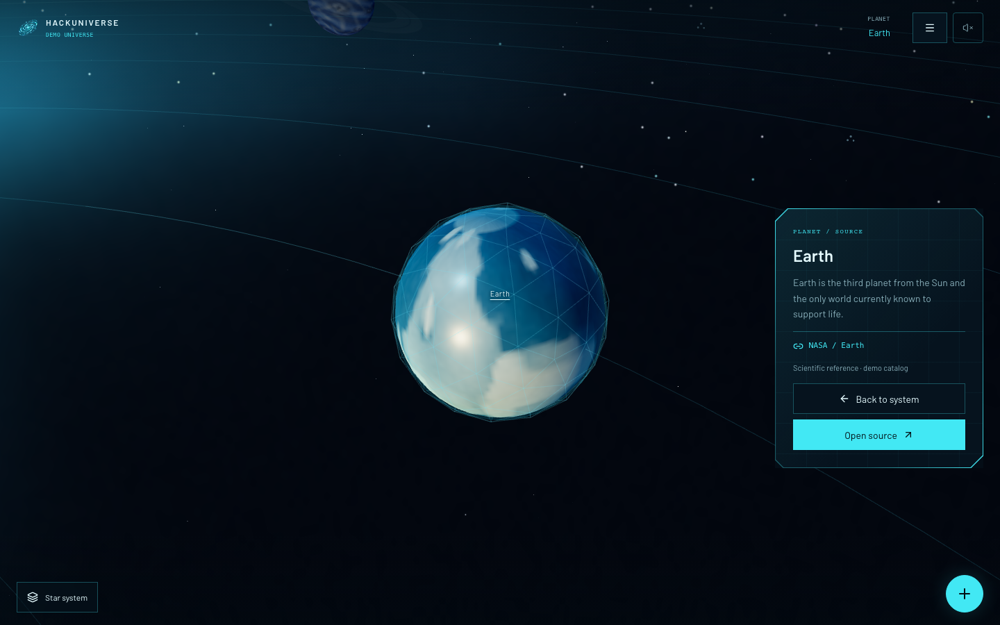
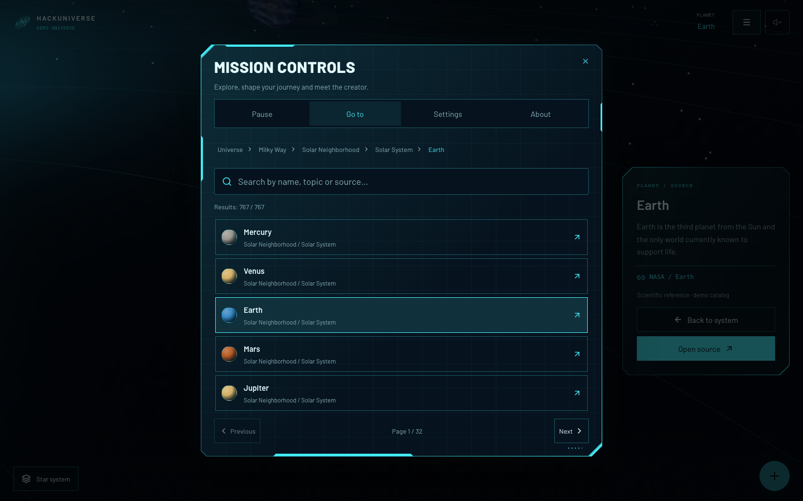
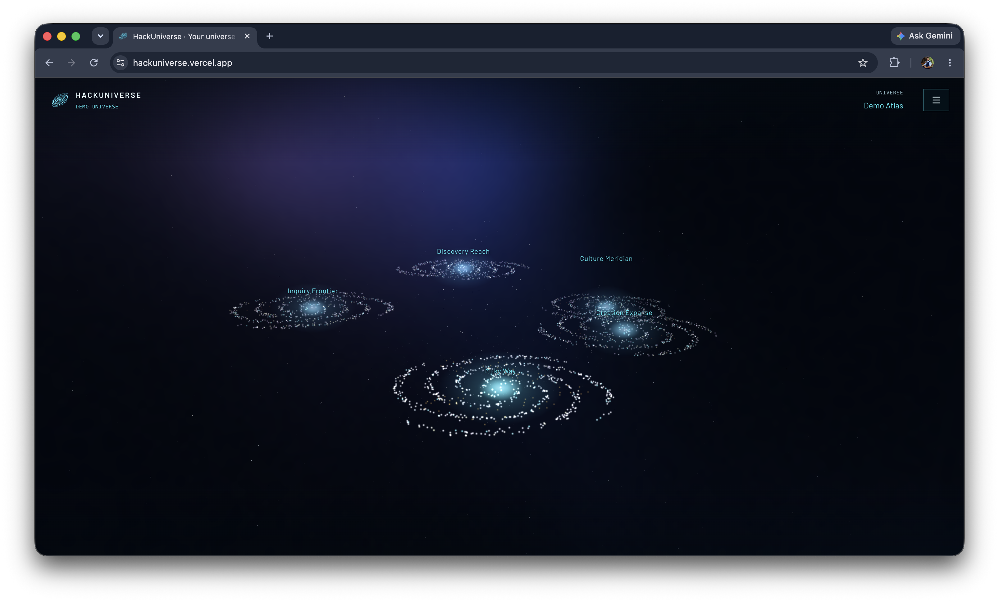
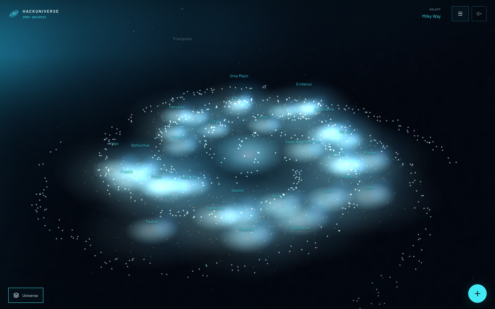
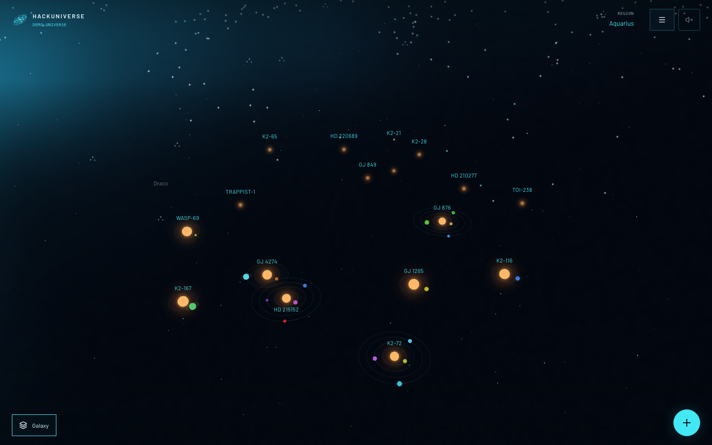
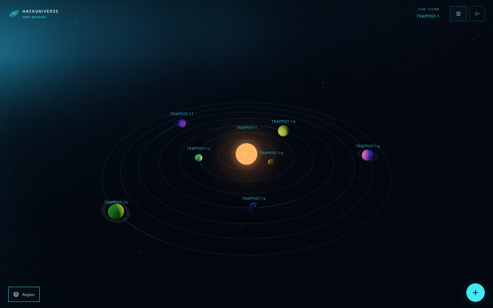
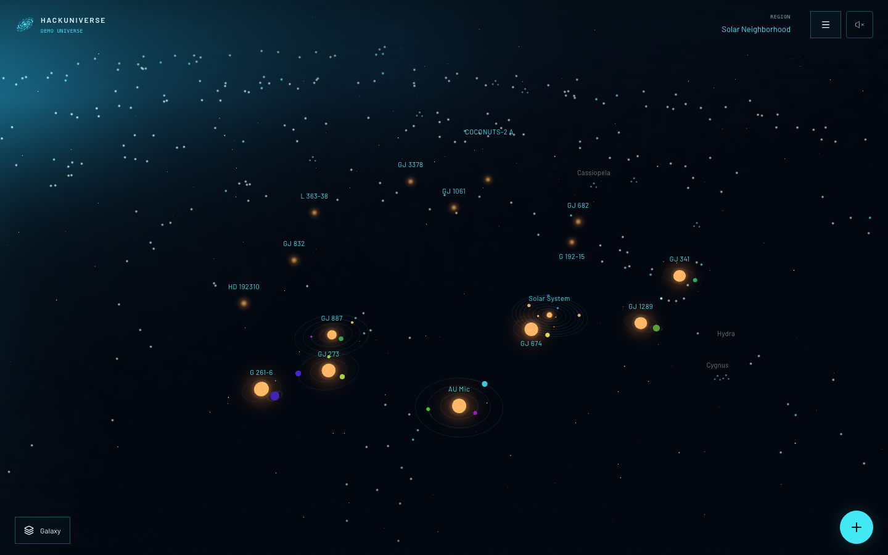
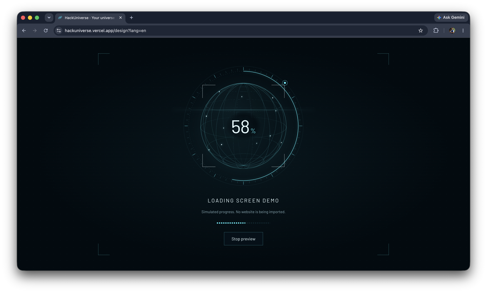

# HackUniverse

Earlier interface walkthrough; the screenshots below show the current factual catalog.

https://github.com/user-attachments/assets/71ee72c3-f5f6-4b40-8359-383dcdcb93ad

**TL;DR:** Turn websites into planets and organize them into systems, galaxies and universes. The web app includes immersive exploration, a searchable atlas, planet/star details, optional flight and a browser-local editor. Its provider-neutral catalog keeps the bundled Demo separate from your Local universes; a Firecrawl search adapter demonstrates normalization. Account authentication, synchronization, live ingestion and the Go API remain planned. New accounts will start with zero planets.

[Explore the live demo](https://universe.velrino.co/) · [Run locally](#run-the-web-app) · [Download the demo (MP4)](assets/demo/video/demo.mp4)

## Product tour

Select any screenshot below to open it at full resolution. Names and descriptions use sourced astronomical records; rendered positions and appearances are illustrative.

| Explore the map | Inspect and navigate |
|:---:|:---:|
| **Focus Earth within its intact system**<br><a href="assets/demo/images/02-earth-planet-details.png"></a> | **Find planets in the searchable atlas**<br><a href="assets/demo/images/03-mission-controls-atlas.png"></a> |
| **See the universe at a glance**<br><a href="assets/demo/images/04-universe-galaxy-overview.png"></a> | **Explore the Milky Way catalog**<br><a href="assets/demo/images/05-milky-way-galaxy-overview.png"></a> |
| **Zoom into a sky region**<br><a href="assets/demo/images/06-constellation-region-overview.png"></a> | **Inspect TRAPPIST-1**<br><a href="assets/demo/images/07-trappist-1-star-system.png"></a> |
| **Explore 16 nearby systems**<br><a href="assets/demo/images/08-solar-neighborhood-systems.png"></a> | Open the hamburger menu → Pause → **Nearby systems** to explore the Solar System, GJ 887, GJ 1061, AU Mic and the other curated nearby hosts. |

**Preview the shared planetary loader** — This component-gallery example uses simulated progress; no website is being imported.

<p align="center">
  <a href="assets/demo/images/01-loading-screen-demo.png"></a>
</p>

## Project structure

- `web/` — Next.js, React, TypeScript, and Tailwind CSS, with modular i18n and shared [Velrino UI](https://github.com/velrino/velrino-ui) components.
- `api/` — Planned Go API.
- `evals/` — Planned Python evaluations.

## Design system

Explore the [shared Velrino UI gallery](https://velrino.github.io/velrino-ui/?theme=cyan&appearance=sci-fi) for colors, typography and interactive components. Design-system links open it in a new tab with the active language, keeping the universe open. Search components from Go to and adjust language, colors and surfaces in Settings. Existing `/design` bookmarks redirect there.

Use these shared components and tokens when building new pages. The [visual reference guide](docs/DESIGN-SYSTEM.md) explains the design direction, and [the web guide](web/README.md) covers component usage and module structure. The browser selects the initial interface language; `?lang=en`, `?lang=pt-BR` or `?lang=fil` overrides it on every page. The global language dialog switches languages without reloading. See the [localization contract](docs/LOCALIZATION.md).

## Universe demo

The home provides a mobile-first, full-screen 3D demo with [767 real planets and 1,255 entities](web/src/modules/universe/data/demo-universe.json) across 450 systems, 32 navigation regions and five real galaxies. Eight planets belong to the Solar System and 759 are confirmed exoplanets from the NASA Exoplanet Archive. The real IAU constellation regions are sky-direction groupings, not physical clouds. Only the Milky Way contains planetary systems. Names/descriptions are sourced; visual sizes, colors, spacing and motion are illustrative. Solar/tour identity is preserved. [Source selection and bounds](docs/UNIVERSE-DATA.md#factual-bundled-demo) keep the demonstration independent of Local catalogs and live ingestion.

Solar Neighborhood contains the Solar System and 15 additional nearby systems, with 34 planets across its 16 systems. Open the hamburger menu → Pause → **Nearby systems** to reach this populated region directly. The nearby selection is curated from source-reported distances within 15 parsecs, not a complete census.

A once-per-browser startup loader runs while the scene prepares in the background, before the welcome entry. Its initial three-second percentage measures animation time; longer scene preparation uses indeterminate progress. See the [startup guide](docs/UNIVERSE-EXPLORER.md#startup-preparation). Start on Earth, watch the first-visit tour widen to the universe, or replay it from your current view. Galaxies have luminous multicolor particles by default and a stronger hover state that preserves their hues. Surrounding spiral particles and neighboring-group stars remain visible as you zoom through the hierarchy. Selecting a planet preserves its whole system; selecting a central star frames that system and opens its details. Planet/star names and descriptions use the shared accessible writing effect while facts and actions appear immediately. One hamburger opens Pause, Go to, Settings and About. Optional third-person flight stays inside the active system, and the Space Jump cutscene remains temporarily disabled.

Organized Demo authoring objects normalize into the same provider-neutral canonical contract, and every bundled entity is explicitly marked `type: "demo"`. This flag identifies the demonstration, not fictional content. This optional object classification is independent of catalog mode; a future hide-demo filter is not implemented. The reusable host also accepts validated catalogs with optional references, URLless objects and an empty root. See the [explorer guide](docs/UNIVERSE-EXPLORER.md), [catalog contract and adapter examples](docs/UNIVERSE-DATA.md) and [spacecraft credits](docs/ASSET-CREDITS.md). This demo does not create real account content or make provider requests.

## Local workspace

Choose Local in the universe menu's Settings to create, edit and delete planets or groups across multiple universes. The guided editor reveals optional fields when needed, suggests the current location and validates only the final save. The floating Actions button and object manager preserve the bundled Demo. Missing ancestors can be created automatically; group deletion includes its descendants. A File → Options → Confirm flow imports JSON backups, with an optional advanced editor; export downloads the complete Local workspace. Changes are saved only in the current browser and origin, with no account sync or automatic upload. Account opens an ephemeral login preview.

See [the local workspace guide](docs/LOCAL-WORKSPACE.md) for usage, storage/locking limits, module boundaries and validation commands. [Frontend issue #36](https://github.com/velrino/hackuniverse/issues/36) and [future integration issue #37](https://github.com/velrino/hackuniverse/issues/37) track the separate scopes.

## Run the web app

```bash
cd web
npm install
npm run dev
```

Open [localhost:3000](http://localhost:3000).

English, Brazilian Portuguese and Filipino are supported. The browser selects the initial language, with English as fallback. Use `?lang=en`, `?lang=pt-BR`, `?lang=fil` or the language dialog to choose explicitly without reloading. See [the web guide](web/README.md) for the shared translation API and example pages.

For the architecture and implementation plan, see [umbrella issue #1](https://github.com/velrino/hackuniverse/issues/1).
