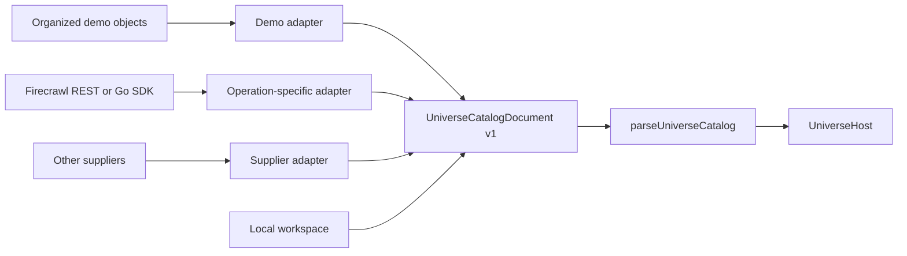

# Universe catalog contract

The explorer consumes one application-owned, provider-neutral catalog. A supplier adapter converts its own input into this contract; the domain, navigation, UI and renderer do not consume supplier responses. The bundled [demo-universe.json](../web/src/modules/universe/data/demo-universe.json) uses organized authoring objects; its dedicated adapter produces this same canonical document before parsing. Authoring/source data and supplier envelopes never become alternate runtime or export contracts.

## Document and validated catalog

Import the pure public boundary without loading the default fixture, a supplier adapter or UI:

```ts
import {
  parseUniverseCatalog,
  type UniverseCatalogDocument,
} from "@/modules/universe/domain";

function loadCatalog(document: UniverseCatalogDocument) {
  return parseUniverseCatalog(document);
}
```

`UniverseCatalogDocument` contains `schemaVersion: 1`, `mode: "demo" | "live"`, `rootId`, an optional `{ kind, id }` `initialTarget`, and an ordered `entities` array. Every entity has an application-owned `id`, `kind`, `parentId`, `name`, `description` and numeric visual `seed`.

The five kinds form a strict hierarchy: `universe → galaxy → cloud → system → planet`. Exactly one universe is the declared root and has a null parent. Every other entity must resolve to a parent of the preceding kind. Groups can be empty; the contract does not require a system or any planets.

`UniverseGroup` covers the four grouping kinds. `UniversePlanet` adds an optional `reference: { label, href? }` and optional string `tags`. A planet need not be a website or have a URL. Provider names, operations, raw payloads, search queries and rankings are not canonical fields. When a discovery term is useful to the application, an adapter can project it into neutral tags.

Every entity may explicitly carry `type: "demo"`. Absence means an ordinary object; neither catalog `mode` nor an ancestor's type assigns it implicitly. The parser accepts only this supported type when supplied, and adapters preserve an explicit application classification rather than deriving it from a supplier response. All bundled entities carry the flag, including real astronomical objects: it identifies the bundled demonstration, not fictional content.

This classification does not implement visibility, ownership or authorization. No hide-demo filter exists yet. A future filtered catalog must preserve a valid root and the ancestors needed by retained ordinary objects, then derive children and counts from the retained records. Hiding a marked ancestor must not discard its ordinary descendants; CSS-only hiding is not a data filter or an authorization boundary.

System groups may also carry optional `star: SystemStar` metadata: required name/description and optional spectral type, effective temperature in kelvin, radius in kilometers, age in billions of years and a reference. This metadata is allowed only on systems; unknown facts can be omitted. It is projected and frozen with the catalog, without creating another entity or planet.

The validated `UniverseCatalog` resolves a required `initialTarget`, defaulting to the root, and derives a readonly `planets` array from the entities. Each derived planet is the same object as its entry in `entities`; callers do not maintain a second set of records. Entity and planet order is preserved.

## Parse at the boundary

[parseUniverseCatalog](../web/src/modules/universe/domain/parse-catalog.ts) accepts `unknown`, validates it and creates owned canonical objects. It freezes the catalog, initial target, entity/planet arrays, entities, references and tags. Mutating the input afterward does not change the validated result. Unknown fields are omitted rather than forwarded, and validation errors do not echo rejected payload or URL values.

Validation enforces:

- Unique, nonblank opaque IDs of at most 256 characters, without control characters. IDs may contain meaningful punctuation and are not restricted to one supplier's format.
- Nonblank names and reference labels of at most 160 characters; descriptions may be empty and contain at most 4,000 characters. Seeds are unsigned 32-bit integers.
- At most 32 tags, each a string of at most 1,000 characters.
- Exactly one declared root, supported kinds, strict parent relationships and a resolvable initial target whose kind matches its entity.
- Optional reference links that normalize to HTTPS URLs without userinfo or control characters. Meaningful ports, queries and fragments are allowed.

Duplicate reference links are valid: generic object identity comes from the application ID, not the href. Website-specific deduplication belongs in the website adapter. URL validation preserves meaningful parameters and is not a secret-removal mechanism; adapters must supply safe, shareable canonical links rather than signed or credential-bearing URLs.

An empty universe is a valid document and starts at its root:

```json
{
  "schemaVersion": 1,
  "mode": "live",
  "rootId": "empty-universe",
  "entities": [
    { "id": "empty-universe", "kind": "universe", "parentId": null, "name": "My universe", "description": "", "seed": 1 }
  ]
}
```

The bundled demo is not an account seed or database migration. New production accounts still start with zero planets.

## Objects without URLs

The [document catalog example](../web/src/modules/universe/data/examples/document-catalog.json) provides a complete hierarchy with a local document planet. Its reference has a label and no href:

```json
{
  "id": "document-field-notes",
  "kind": "planet",
  "parentId": "document-system",
  "name": "Field Notes",
  "description": "A fictional local document about landscape observations.",
  "seed": 205,
  "reference": { "label": "Notebook / Field Notes" },
  "tags": ["fieldwork", "local document"]
}
```

References and tags can also be omitted entirely. Planet details use the canonical name and description, show reference metadata only when present, and do not construct a URL for a URLless object. A host can identify its bundled demo references as factual and expose scientific source links. This presentation permission is supplied only for the factual Demo source; imported Local demo objects retain their previous reference behavior. Validated live references and system-star source links remain available.

## Default source and host composition

The [default catalog adapter](../web/src/modules/universe/adapters/catalog/index.ts) normalizes organized demo authoring JSON and validates it with the canonical parser. `DemoUniverseHost` supplies that dataset and its optional tour to `UniverseWorkspaceHost` for `/`. The workspace host chooses immutable Demo or editable Local data; Account currently opens only a login preview. The reusable `UniverseHost` requires an already validated `catalog` prop and does not choose a supplier or import the fixture itself. The universe hosts are available through `@/modules/universe/host`; import the workspace host through `@/modules/universe-workspace`.

The browser workspace wraps multiple canonical single-root catalogs in its own versioned envelope, preserving this document contract and globally unique application IDs. Pure workspace operations validate the result after creation, edits and cascading deletion. Missing ancestors can be created as empty groups; demo records are never copied into a new workspace. Persistence, concurrent-tab locking, quotas and the future account boundary are documented in [the local workspace guide](LOCAL-WORKSPACE.md).

## Factual bundled demo

The current demo contains **767 real planets, 450 systems, 32 navigation regions and 20 named galaxies (1,270 entities)**. Eight planets belong to the Solar System; 759 confirmed, non-controversial exoplanets belong to 449 single-star hosts selected from the [NASA Exoplanet Archive](https://exoplanetarchive.ipac.caltech.edu/). Only the Milky Way is populated. The other 19 galaxies remain empty destinations, without invented planets.

The 20 curated galaxy records include Bode's Galaxy (M81), Black Eye (M64), Sunflower (M63), Southern Pinwheel (M83), Messier 95/96/98/99/100, Sculptor (NGC 253), NGC 1300/1365/2403/2903 and Fireworks (NGC 6946), alongside the original five. Each record has a factual description and a primary NASA, ESA/Hubble or ESO source URL, retained in `provenance.galaxySources`. Appending these destinations preserves the existing galaxy IDs, order and seeds, as well as all system and planet relationships. The procedural spiral appearance remains illustrative, including for barred and flocculent galaxies.

The authoring source nests `catalog`, `universe.galaxies[].clouds[].systems[].planets[]` and `provenance`. Each object owns an explicit canonical `kind`, name, description, ID, seed and optional star/reference metadata. The [Demo adapter](../web/src/modules/universe/adapters/catalog/demo/normalize.ts) checks that `kind` agrees with its place in the tree, derives `parentId`, preserves order, projects only canonical fields and uses the existing parser. Legacy private authoring without a declared kind can still derive it; every bundled object declares it. Provenance and supplier fields are not copied into entities or Local exports.

`kind` describes the object category (`universe`, `galaxy`, `cloud`, `system`, `planet`); `type: "demo"` independently classifies its demonstration status. Keep these fields separate when importing into a future database or dashboard. The canonical document already stores both `kind` and the derived `parentId`, so aggregation does not depend on ID prefixes, names, tags or the supplier. For example, a future table of canonical entities could use:

```sql
SELECT kind, COUNT(*) AS total
FROM universe_entities
WHERE type = 'demo'
GROUP BY kind;
```

The current bundled counts are one universe, 20 galaxies, 32 regions (`cloud`), 450 systems and 767 planets. This describes the data boundary; no database or dashboard is added by this change.

The [source manifest](../assets/data/astronomy/source-manifest.json) records the dated NASA query, exact snapshot SHA-256, coordinate grouping and attribution. [generate-demo-source.py](../web/scripts/generate-demo-source.py) refreshes source snapshots; [generate-demo.mjs](../web/scripts/generate-demo.mjs) deterministically rebuilds the authoring JSON offline. Run `npm run test:demo` from `web/` to verify it. Descriptions use present discovery/orbital facts and omit missing or limited values, without invented surface, climate, life or habitability claims. Composite archive fields can come from different references and are not one physical solution.

Solar Neighborhood contains the Solar System and 15 additional nearby planetary systems, including GJ 887, GJ 1061 and AU Mic: 16 systems and 34 planets in the initial region. The curated nearby hosts have source-reported distances within 15 parsecs. They are a bounded selection, not a complete census. Their complete eligible planet groups are added without duplicating or moving any existing system; existing IDs, parents, seeds and Solar/tour identity remain stable.

The other populated regions use real IAU constellations to organize exoplanet hosts by sky direction. They are observational navigation groups, not physical interstellar clouds or claims that their members are close in three-dimensional space. Demo presentation labels this level Region; the domain `cloud` kind and Local presentation are unchanged. Solar Neighborhood remains the stable Solar System tour stop. The Demo host also supplies a **Nearby systems** action in Pause that navigates directly to this region; it is absent from Local.

Authoring limits are **32 total regions, 16 systems per region, 512 exoplanet hosts and 1,024 total planets**, keeping complete eligible systems. The source pool contains single-star, non-circumbinary, non-controversial confirmed planets whose hosts are within 100 parsecs; the bundled selection is intentionally incomplete. These limits apply only to Demo selection, not the provider-neutral domain or Local storage. Renderer budgets and atlas pagination remain independent; see the [explorer guide](UNIVERSE-EXPLORER.md#scene-detail-and-scale) for measurements and limitations.

Solar planet IDs, seeds and order remain Mercury through Neptune. The tour retains `planet-earth`, `system-solar`, `cloud-local-interstellar`, `galaxy-milky-way` and `universe-demo-atlas`; verified legacy names for Barnard's star, Ross 128 and Lalande 21185/GJ 411 retain their application identity. The Sun's `G2 V`, `5772 K`, `695700 km` and approximate `4.6` billion-year metadata keep their [NASA fact-sheet](https://nssdc.gsfc.nasa.gov/planetary/factsheet/sunfact.html) and [NASA Sun facts](https://science.nasa.gov/sun/facts/) references. New real records never reuse unrelated fictional identities.

This replaces the former fictional website/sector fixture. Local catalogs, `hackuniverse.workspace.v1`, account seeds and canonical import/export are unchanged. Links to removed fictional destinations use existing invalid-link recovery. Catalog loading makes no runtime NASA, Firecrawl, image or content requests.

Keep IDs, parents, seeds and child ordering stable when editing display content. They control selection, deterministic appearance, orbital placement, hierarchy previews and camera continuity. A rendered central star is a selectable system anchor backed by optional system metadata, not another catalog record.

## Supplier adapters

The optional Firecrawl search normalizer has its own public entry:

```ts
import { parseUniverseCatalog } from "@/modules/universe/domain";
import {
  normalizeFirecrawlSearch,
  type FirecrawlSearchInput,
} from "@/modules/universe/adapters/catalog/firecrawl";

function catalogFromSearch(input: FirecrawlSearchInput) {
  return parseUniverseCatalog(normalizeFirecrawlSearch(input));
}
```

The [synthetic REST-v2 Search input example](../web/src/modules/universe/data/examples/firecrawl-search.json) includes application-owned groups, destination systems, IDs and visual seeds separately from a `success`/`data.web` search response. A batch's mapping connects each one-based result position to an application planet ID and seed. Mapping order is retained; provider ranking never defines object identity.

The normalizer validates supplier response shape, success, batch IDs, complete unique mappings, optional result positions, destination systems, result metadata and duplicate normalized website URLs. It projects title/description into canonical name/description, URL into a reference, and query into tags. Explicit group/mapping demo types and system-star context come from the application, not the provider ranking or catalog mode. Raw response fields and provider credentials are not copied. It rejects recognizable credential/signature parameters rather than silently stripping them; callers remain responsible for safe source data. The canonical parser then validates and freezes the resulting application tree.

This is a local transformation, not a live integration: it performs no fetch, SDK call, import job or persistence. Additional suppliers implement the same outward document contract in their own adapters; they do not add supplier fields to domain types or conditionals to the renderer.

### REST and Go SDK boundaries

The existing normalizer accepts Firecrawl REST Search's `success/data.web` envelope, not every operation or SDK return. The current [Go SDK](https://docs.firecrawl.dev/sdks/go) unwraps responses: Scrape returns a document with flexible metadata/JSON, while Search returns result collections directly. REST Extract is an asynchronous job: [start](https://docs.firecrawl.dev/api-reference/endpoint/extract) and [status](https://docs.firecrawl.dev/api-reference/endpoint/extract-get) envelopes contain job state, not completed catalog content. Each adapter must validate its actual version, operation and completion before normalization. An unknown JSON shape or unfinished job is never passed directly to the renderer.

Future Go or alternate-supplier integrations produce the same `UniverseCatalogDocument`. The host supplies application identity, groups, seeds and ordering; adapters project safe names, descriptions and references. Provider clients, credentials, raw pages, ranking, pagination and job state stay outside the contract. Crawling more pages does not create more planets: aggregation retains one application website identity. This demo refresh adds no Go backend or live ingestion.



## Selectors and scene projection

[catalog.ts](../web/src/modules/universe/domain/catalog.ts) contains pure selectors. Entity, parent, children and breadcrumb lookups use the authoritative hierarchy. `findPlanet` resolves a canonical planet, and `getPlanetCount` counts planet descendants without adding a visual star. Scene projection builds local identity, children and count indexes once per call, avoiding repeated ancestor scans while retaining no shared cache between catalogs. Search matches every whitespace-separated term against name, description, optional reference label/href and tags; an empty search returns all planets in stable order.

`getSceneView` projects only rendering fields: stable IDs, kinds, labels, counts, seeds, colors and nested descendants. Its optional `UniverseSceneView.anchor` is the current group's projected `SceneNode`; `nodes` uses the same child objects as `anchor.children`. Optional readonly `ancestors` runs from the universe root to the immediate parent. These nodes share one projected root tree, retaining complete sibling arrays and their ordering for exact coordinate mapping and bounded stellar context. The renderer reads this context without modifying it. Both fields belong to the view model, not the canonical JSON contract; they add no supplier fields or entities.

Selecting a planet returns its complete parent-system view with the same scene key, mode, nodes, anchor, ancestors and star name. The camera focuses within that world while siblings, geometry, orbital state and surrounding context survive. Group keys remain `${kind}:${id}`; suppliers do not replace them with request IDs or rankings. Empty groups yield empty nodes, and unknown targets yield an empty cluster view.

Interface localization does not translate or rewrite catalog content, labels, tags or reference links. Camera, appearance and rendering details are documented separately in [the explorer guide](UNIVERSE-EXPLORER.md).

## Validation

From `web/`, run `npm run test:demo` and `npm run test:catalog`. Native Node tests cover canonical and supplier boundaries, URLless/empty catalogs, hierarchy and input failures, safe projection, immutability, derived identity, adapter conversion and projection isolation. The runner compiles tests with the existing TypeScript dependency into ignored `.catalog-tests/` output. Demo checks verify canonical parity, Solar/tour identity, factual snapshot membership/integrity and selection bounds. `npm run test:scene` separately checks tour continuity, distance bounds and shared orbital motion.

`npm run test:workspace` separately checks local CRUD, the multi-universe envelope, persistence limits, conflicting snapshots and write-lock behavior; see [workspace validation](LOCAL-WORKSPACE.md#validation-and-roadmap).
